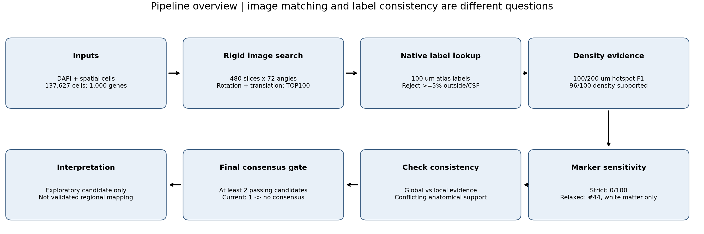
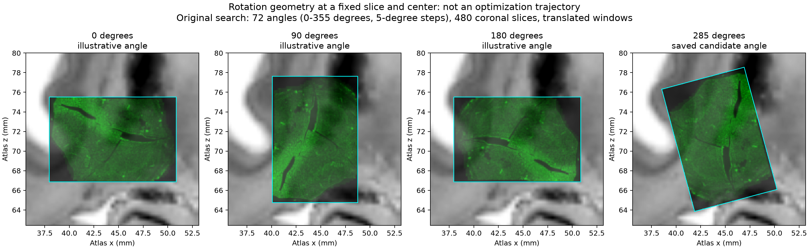
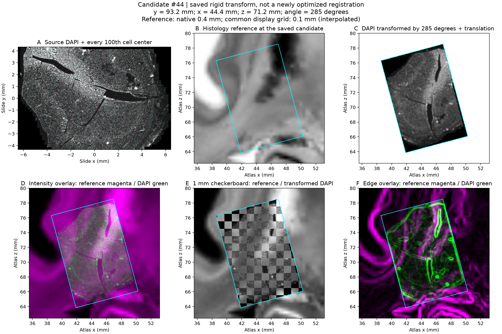
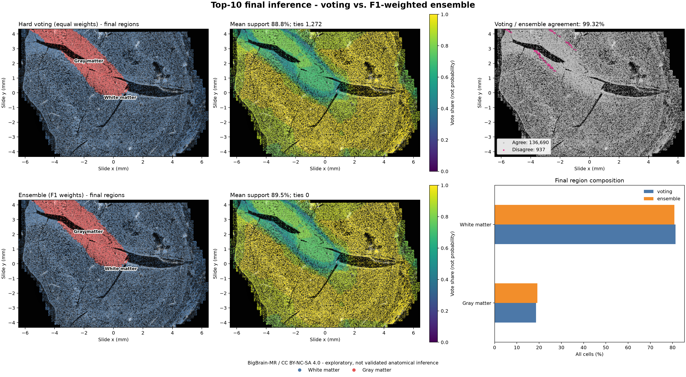
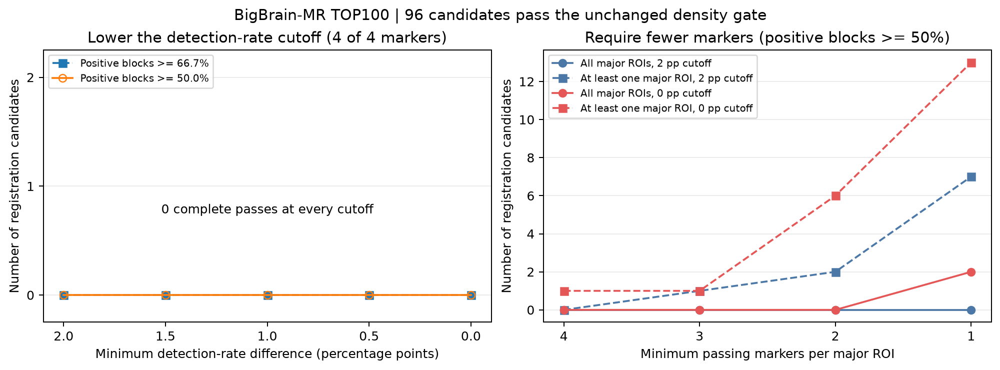

# Exploratory regional mapping with BigBrain-MR

## Abstract

This project explores the registration of a DAPI image and spatial transcriptomic cell coordinates to a human brain reference, followed by image-, density-, and marker-based assessment of regional assignments. Despite the historical use of "CCF" in the repository name, the reference is **human BigBrain-MR with 20 tissue/anatomical labels, not the mouse Allen CCFv3**.

The analysis comprises **137,627 cells, a 1,000-gene panel, and a DAPI field measuring approximately 12.899 x 8.674 mm**. The registration pipeline searches 480 coronal slices and 72 in-plane rotations in the 400-um reference, optimizes translated image windows, and queries the native 100-um label volume to assign cell-level regions. The initial pool of 10 candidates was expanded to 100. Candidates were evaluated using local cell-density hotspots and predefined marker panels. No candidate satisfied the original strict marker gate. Under a relaxed gate requiring at least three directionally consistent markers in at least one major ROI, only the white-matter component of image-registration candidate #44 passed. However, pooled regional marker expression contradicted parts of this assignment, particularly the white-matter and putamen labels.

**Current outcome: one partially supported candidate, no validated anatomical mapping, and no final marker-filtered voting/ensemble annotation.** The high agreement of the earlier unfiltered TOP10 voting and ensemble results is not independent evidence of registration accuracy. This report separates the implemented image search, its visualization, marker consistency, and anatomical validation.

## Results

### 1. End-to-end workflow



**Figure 1 | Image search, marker screening, and the final decision gate.** DAPI and spatial cell coordinates are placed in a common physical coordinate system. Rigid image registration searches coronal slices, rotations, and translations; candidate cell coordinates are then queried against native atlas labels. Density evidence and marker evidence serve different purposes: hotspot F1 ranks spatial overlap, whereas markers test consistency with expected tissue composition. The strict marker screen returned no passing candidate; the relaxed screen supported white matter in candidate #44 only. Final voting/ensemble requires at least two eligible candidates and was therefore not performed. Image similarity, hotspot F1, and marker consistency are not calibrated anatomical confidence scores.

| Component | Implementation |
|---|---|
| Coordinate preparation | Transform cell centers into mosaic pixels, then centered physical slide coordinates in millimeters |
| DAPI preparation | Contrast adjustment, tissue support, cell-density weighting, and candidate tear exclusion |
| Image registration | 2D rigid rotation and translation at fixed physical scale |
| Search space | 480 coronal slices; 0-355 degrees in 5-degree steps; translated image windows |
| Candidate pool | 100 spatially separated, image-ranked candidates |
| Label assignment | Nearest-neighbor lookup in native 100-um BigBrain-MR labels |
| Density evidence | ROI-hotspot F1 at 100- and 200-um smoothing scales |
| Marker evidence | Predefined panels evaluated within matched spatial blocks |
| Final aggregation | Equal-weight voting and F1-weighted ensemble only if at least two candidates pass |

The reference and DAPI do **not** enter the pipeline only at the plotting stage: the rotation/translation search explicitly uses the DAPI-derived intensity pattern. The selected rigid transform is also applied to spatial cell coordinates.

#### Inputs and reproducibility

The executed analysis is preserved in [the main notebook](./CCF/Untitled.ipynb), with marker screening implemented in [bigbrain_marker_screen.py](./CCF/bigbrain_marker_screen.py).

- Required local inputs are `adata.h5ad`, `manifest.json`, `micron_to_mosaic_pixel_transform.csv`, and `mosaic_DAPI_z0_downsampled.tif`. They were outside the working analysis directory and are **not included in this repository**.
- Update `DATA_DIR`, `OUTPUT_DIR`, and remaining absolute paths in reference/restoration cells before rerunning. Preserved historical outputs contain paths from the original execution environment.
- The original environment used Python 3.11 in the `scrna` conda environment. No fully pinned dependency lockfile is provided.
- Main packages: `scanpy`, `anndata`, `numpy`, `pandas`, `scipy`, `statsmodels`, `matplotlib`, `opencv-python`, `nibabel`, `tifffile`, `scikit-image`, `requests`, and `ipywidgets`. Notebook execution also requires Jupyter/IPython.
- BigBrain-MR reference volumes are downloaded from [Zenodo](https://zenodo.org/records/7432527). Full image search takes several minutes or longer and requires several GB of memory.
- Saved CSVs support rerunning cutoff sensitivity and marker-assessment summaries without repeating image search. Cell-level reprojection and expression recomputation require the original inputs and reference.
- TOP10 baseline outputs and later TOP100 marker-screening outputs are retained separately. The TOP100 density cell saves the full ranking while maintaining a separate input subset for older TOP10 comparison functions.
- The explanatory overlay figures can be regenerated with:

```bash
python CCF/generate_report_figures.py \
  --data-dir /path/to/CCF_annotation \
  --output-dir CCF/BigBrain_marker_screen/20261120T003919.939246Z
```

This command adds diagnostic figures only; it does not rerun or alter candidate selection, marker cutoffs, or anatomical labels.

### 2. Rotation, translation, and DAPI-reference alignment

The search compares internal DAPI intensity patterns with the histological reference, using tissue support and cell-density weighting. It rejects candidates with at least 5% of cells outside atlas tissue or in CSF, and rechecks this condition at 100-um label resolution. A further empirical constraint rejects overlap between high-density slide regions and very dark synthetic-T1 pixels. These constraints do not establish anatomical ground truth.

Spatial binning of approximately 3.2 mm in x/z and 2 mm in y, together with a nearby-candidate exclusion condition, reduces candidate redundancy. This is a fixed-scale rigid search: **scaling, reflection, oblique section planes, and nonlinear tissue deformation are not optimized**.



**Figure 2 | How rotation changes DAPI placement at a fixed atlas location.** The reference slice and candidate center are held fixed at candidate #44's saved location. Green overlays show the DAPI image at 0, 90, 180, and 285 degrees; cyan outlines show the transformed rectangular DAPI image footprint. The 285-degree panel uses the angle stored for candidate #44. The other angles are illustrative: **this montage is not a recorded optimization trajectory, does not recompute the search score, and does not demonstrate that candidate #44 is the global best match**. The actual search evaluated 72 angles across 480 slices and translated windows. The transparent rectangle is an image footprint, not an estimated tissue boundary.



**Figure 3 | Direct registration diagnostics for candidate #44.**

- **A:** Source DAPI in physical slide coordinates, with every 100th cell center displayed in cyan for readability. All 137,627 cells remain part of the analysis.
- **B:** Histological reference at the saved candidate's coronal slice and location.
- **C:** The DAPI image after applying the saved 285-degree rotation and translation. Blank areas are outside the transformed slide image.
- **D:** Complementary-color overlay: inverted dark histological staining is magenta and DAPI is green. Bright overlap indicates coincident display signal, not a measured registration probability.
- **E:** A 1-mm checkerboard alternating reference signal and transformed DAPI inside the slide footprint. It helps expose discontinuities or incompatible tissue patterns.
- **F:** Gradient-based edge overlay using the same magenta/green convention, allowing qualitative assessment of structural alignment.

Panels B-F share atlas coordinates. The native reference resolution is **0.4 mm**; the common display grid is 0.1 mm and is interpolated, not new reference detail. Display contrast, smoothing, inversion, and gradient visualization are for inspection and do not reproduce the search's weighted scoring image exactly. These panels make a previously missing direct DAPI-reference overlay visible without changing the saved transform.

### 3. Initial TOP10 assignments and the gray/white label audit

The initial best candidate assigned 77.25% of cells to white matter and 22.75% to gray matter. Unfiltered TOP10 voting assigned 81.33% to white matter and 18.67% to gray matter; the F1-weighted ensemble assigned 80.81% and 19.19%, respectively. Voting and ensemble agreed for approximately 99.32% of cells.



**Figure 4 | Baseline consensus before marker screening.** The figure compares cell-level region assignments, vote support, disagreement between voting and ensemble, and regional composition. Voting uses equal candidate weights, whereas ensemble weights are proportional to hotspot F1. Both operate on the same initial candidate pool, so high agreement measures internal consistency rather than anatomical accuracy. This is a **historical baseline**, not a final marker-filtered result.

Marker expression contradicted the expected baseline assignments: in the voting result, `MOG` was detected in approximately 24.0% of white-labeled cells versus 70.7% of gray-labeled cells, whereas `SLC17A7` was detected in 68.6% versus 19.4%.

The official BigBrain-MR Table I mapping, **1 = White matter and 2 = Gray matter**, matched the implementation. Independent native-voxel queries and vote recomputation during the audit did not identify discrepancies with the initial saved cell assignments. Therefore, labels were not corrected by simply swapping names 1 and 2. Correct lookup logic does **not** establish correct registration placement.

Baseline data: [candidate region counts](./CCF/BigBrain_top10_region_counts.csv) and [consensus metadata](./CCF/BigBrain_top10_consensus_metadata.json).

### 4. TOP100 density ranking and predefined marker screening

Of the [100 image-registration candidates](./CCF/BigBrain_fit_candidate_ranking_top100.csv), **96 passed the existing density gate**. Cells with zero total expression (6,893 cells) were excluded from marker screening and the later candidate-specific DEG analysis.

Hotspots are calculated on approximately 100-um bins using area-corrected cell density. Local Gaussian smoothing at 100/200 um is compared with a 500-um background. Each scale's ROI overlap is summarized as:

```text
F1 = 2 x intersection / (ROI bins + hotspot bins)
fit_score = min(F1 at 100 um, F1 at 200 um)
```

Both scales must show positive density excess within 1-mm blocks containing multiple labels. **F1 is not registration accuracy or a probability.** The ranking's representative `region` denotes the ROI with the strongest hotspot fit; it need not be the largest region, every cell's region, or the region supported by markers.

| Target tissue/ROI | Screening markers | Confirmation markers | Within-block comparator |
|---|---|---|---|
| White matter | MOG, CLDN11 | MOBP, OPALIN | Gray matter |
| Gray matter | SLC17A7, SYT1 | GAD1, CAMK2A | White matter |
| Putamen | PDE10A, ADORA2A | TAC1, PENK | Gray matter |

These are cell-type/tissue-composition panels, not uniquely anatomical regional markers. Striatal markers do not by themselves distinguish putamen from other striatal structures.

Screening and confirmation panels were evaluated on different subsets of a 2-mm checkerboard. Each compared region required at least 20 nonzero-count cells per block and at least three matched blocks per stage. Labels containing at least 5% of all cells were treated as major ROIs.

The strict gate required all four markers in every major ROI, a median detection-rate difference of at least 2 percentage points, and positive differences in at least two-thirds of blocks. **No candidate passed.** Not every candidate had an assessable panel: unsupported ROI types and insufficient matched blocks were not counted as passes.

Audit data: [candidate decisions](./CCF/BigBrain_marker_screen/20261120T003919.939246Z/candidate_audit.csv), [marker evidence](./CCF/BigBrain_marker_screen/20261120T003919.939246Z/marker_evidence.csv), and [screening configuration](./CCF/BigBrain_marker_screen/20261120T003919.939246Z/summary.json).

### 5. Cutoff sensitivity and ROI-specific candidate selection



**Figure 5 | Candidate counts across 40 cutoff combinations.** The denominator is the 96 density-supported registration candidates, not cells or patients.

- **Left:** The minimum detection-rate difference decreases from 2 to 0 percentage points while four passing markers per ROI remain required. Curves compare positive-block-share thresholds of two-thirds and 50%. No candidate passes every major ROI at any of these cutoffs.
- **Right:** The minimum number of passing markers decreases from four to one at a fixed positive-block-share threshold of 50%. Blue curves use a 2-percentage-point effect cutoff and red curves use a zero-point cutoff. Solid lines require **all major ROIs** to pass; dashed lines require **at least one major ROI** to pass.
- At zero cutoff, a marker still requires a **strictly positive** difference; an exact zero is excluded.
- Requiring only one marker yields two candidates passing every major ROI (original image ranks 97 and 98), but this was **not** the subsequently chosen operating point.

The chosen exploratory operating point was **at least one major ROI, at least three markers, a positive detection difference, and positive direction in at least 50% of blocks**, while retaining existing density and block requirements.

| Major-ROI, density-supported candidates | Pass | Direction not supported | Insufficient matched blocks |
|---|---:|---:|---:|
| White matter: 84 candidates | 1 | 65 | 18 |
| Gray matter: 69 candidates | 0 | 66 | 3 |
| Putamen: 7 candidates | 0 | 0 | 7 |

The ROI-specific candidate sets overlap and their denominators should not be added. The seven putamen cases were **not assessable**, rather than seven demonstrated marker-direction failures.

Only **white matter in candidate #44** passed. Its four white-matter markers showed positive differences relative to gray matter in matched blocks. Because only one candidate passed, final voting/ensemble was not run. Earlier `BigBrain_top10_*` files remain baseline results only.

Data: [cutoff table](./CCF/BigBrain_marker_screen/20261120T003919.939246Z/marker_cutoff_scree.csv), [selected-marker evidence](./CCF/BigBrain_marker_screen/20261120T003919.939246Z/marker_selection_any_roi_min3_0pp.csv), and [ROI-specific audit](./CCF/BigBrain_marker_screen/20261120T003919.939246Z/region_specific_candidate_audit.csv).

### 6. Reference context and cell-level labels for candidate #44

Candidate #44 has a saved rotation of **285 degrees** and translation **x = 44.4 mm, y = 93.2 mm, z = 71.2 mm**. Its representative density ROI is putamen and its hotspot `fit_score` is approximately 0.302. The ROI supported by the relaxed marker gate, however, is white matter.


**Figure 6 | Full-slice reference context and candidate-centered magnification.** The left column shows BigBrain-MR histology and the right column shows **synthetic T1**, not a directly acquired patient MRI. The upper row shows the full coronal slice and the lower row magnifies the candidate location. Cyan outlines show the transformed full DAPI image footprint; they do not represent the segmented tissue boundary. Both contrasts use 400-um reference data.


**Figure 7 | Spatial cell labels and atlas context.** The left panel overlays cell-level labels on the source DAPI image, while the right panel shows the cropped atlas label map and transformed cell locations. Colors distinguish white matter, gray matter, and putamen. This figure displays the assigned labels, not a direct intensity registration test; Figure 3 provides that complementary diagnostic. The legend distinguishes the partially supported white-matter component from regions retained for comparison. Support for one component must not be interpreted as validation of the entire candidate.

### 7. Region-wise one-versus-rest DEG and two-gene dot plot

For candidate #44, white matter, gray matter, and putamen were each compared with the pooled cells from the other two regions. After excluding zero-total-count cells, expression was normalized to 10,000 panel transcripts per cell (CP10K) and log1p-transformed. Two-sided Mann-Whitney U tests were performed, followed by Benjamini-Hochberg adjustment across all panel genes within each comparison.

Top markers required adjusted p < 0.05, `log2((mean CP10K target + 1)/(mean CP10K rest + 1)) >= 0.25`, target detection >= 10%, and a higher detection rate than the pooled rest. Two genes per ROI were selected in descending log2FC order.

| Current assigned label | Top two one-versus-rest genes |
|---|---|
| White matter | CAMK2A, EGR1 |
| Gray matter | CUX2, PARM1 |
| Putamen | MOBP, LRP2 |


**Figure 8 | Expression contrasts conditional on the assigned labels.** Rows are the three candidate-specific regions; columns are the two selected genes per region, grouped by the region in which each gene was enriched. Dot size is the fraction of cells with detected transcripts, and color is mean log1p(CP10K) across the region's included cells. These genes were selected **using the current region assignments**, so the plot does not independently validate those assignments. In particular, selection of `MOBP` for putamen and `CAMK2A` for white matter warrants anatomical reconsideration. Pooled-rest enrichment does not guarantee specificity against each other ROI separately.

Cell-level tests do not account for spatial dependence or biological replication. Stored p-values of zero can reflect numerical underflow rather than exact zero probability.

Data: [all 3,000 DEG rows](./CCF/BigBrain_marker_screen/20261120T003919.939246Z/candidate_44_one_vs_rest_DEG.csv) and [the six selected genes](./CCF/BigBrain_marker_screen/20261120T003919.939246Z/candidate_44_one_vs_rest_top2_markers.csv).

### 8. Marker-based assessment of regional mapping reliability

Predefined marker panels, rather than the newly selected top-two DEGs, were used to assess tissue-composition consistency.

| Assigned region | Pooled one-versus-rest marker direction | Within-block marker direction | Interpretation |
|---|---|---|---|
| White matter | 4/4 myelin markers opposite to expectation | 4/4 supported versus gray matter | Local and global evidence conflict |
| Gray matter | 4/4 neuronal markers supported | 1/4 supported versus white matter | Partial, inconsistent support |
| Putamen | 4/4 striatal markers opposite to expectation | Insufficient matched blocks | Assignment not supported by the available diagnostics |


**Figure 9 | Expected marker panels versus observed regional contrasts.** Rows are assigned atlas regions. Columns contain the predefined white-matter, neuronal, and striatal marker panels. Black rectangles mark each row's expected panel. Red indicates increased mean expression relative to the pooled other ROIs; blue indicates decreased expression. Values are `log2((mean CP10K target + 1)/(mean CP10K rest + 1))`, not confidence scores. The predominantly negative white-matter and putamen target panels reveal contradictions that the local white-versus-gray screen alone does not capture.

Within-block and pooled comparisons use different reference populations and spatial compositions, so they can disagree. The same markers and tissue were also used during candidate selection; this assessment is therefore **not independent validation**, and no calibrated mapping-reliability percentage is reported.

Data: [assessment summary](./CCF/BigBrain_marker_screen/20261120T003919.939246Z/candidate_44_marker_reliability_summary.csv) and [per-marker evidence](./CCF/BigBrain_marker_screen/20261120T003919.939246Z/candidate_44_marker_reliability_evidence.csv).

## Conclusion

1. **The pipeline does include DAPI-based rotation and translation search**, followed by the same geometric transformation of spatial cell coordinates. The new direct overlays make this step more transparent; they do not improve the registration by themselves.
2. No simple gray/white label-name inversion was found, but correct voxel lookup and internally consistent voting did not establish anatomically correct placement.
3. Expanding the search pool to 100 candidates did not yield a strict marker-screen pass. A relaxed gate supported white matter in candidate #44 only, and the global marker profile remained contradictory. No validated final regional annotation or marker-filtered consensus is claimed.
4. The current outputs provide **exploratory evidence about candidate placement and tissue composition**, not calibrated mapping probabilities or definitive anatomical boundaries.
5. Further assessment should use cortical-white-matter boundaries, independent anatomical landmarks, full-section histological context, independent references/specimens, and markers not used for candidate selection. Landmark-guided or deformable registration should be considered where appropriate.
6. Cutoffs and candidates were explored on the same dataset. Selection bias and repeated testing must be considered; post hoc relaxation or renaming labels must not be presented as independent validation.

### Outputs and historical reports

- [Executed main notebook](./CCF/Untitled.ipynb): preserved analysis outputs. **Its original narrative and historical output language are retained; only this README was translated.**
- [Marker-screening implementation](./CCF/bigbrain_marker_screen.py).
- [Explanatory-figure generator](./CCF/generate_report_figures.py): source for Figures 1-3.
- [Latest TOP100 run folder](./CCF/BigBrain_marker_screen/20261120T003919.939246Z/): candidate audits, cutoff sensitivity, ROI-specific selection, reference images, DEG, and reliability diagnostics.
- [Historical overall report](./CCF/BigBrain_%EB%B6%84%EC%84%9D_%EC%A0%84%EC%B2%B4_%EB%B3%B4%EA%B3%A0%EC%84%9C.pdf) and [historical algorithm report](./CCF/BigBrain_%EB%B6%84%EC%84%9D_%EC%95%8C%EA%B3%A0%EB%A6%AC%EC%A6%98_%EC%83%81%EC%84%B8_%EB%B3%B4%EA%B3%A0%EC%84%9C.pdf): generated **before TOP100 marker assessment**. Where interpretations differ, use this README and the latest run folder.
- Earlier TOP10 run folders, figures, and tables are retained for provenance. Kernel IPC sockets, Python caches, and automatic notebook checkpoints are excluded.

### References and reuse conditions

- C. Sainz Martinez et al. **BigBrain-MR: a new digital phantom with anatomically-realistic magnetic resonance properties at 100-um resolution for magnetic resonance methods development.** NeuroImage (2023). [Article](https://doi.org/10.1016/j.neuroimage.2023.120074), [preprint including Table I](https://arxiv.org/abs/2212.08165), [reference data](https://zenodo.org/records/7432527).
- BigBrain-MR is distributed under **CC BY-NC-SA 4.0**. Reference-derived figures require compliance with the original attribution, noncommercial-use, and share-alike terms. This repository does not grant new rights over the source reference data. Figures 2, 3, 6, and 7 contain or derive from BigBrain-MR images or labels; consult the source terms before reuse.
- Siletti et al. **Transcriptomic diversity of cell types across the adult human brain.** Science (2023). [Article](https://doi.org/10.1126/science.add7046). This is background for marker interpretation, not a validation of the present cutoffs or registration accuracy.
- [Allen MERFISH registration tutorial](https://alleninstitute.github.io/abc_atlas_access/notebooks/merfish_ccf_registration_tutorial.html): methodological context for coordinate-to-label joins. The present analysis did not execute the tutorial's Allen CCF/ANTs registration.
