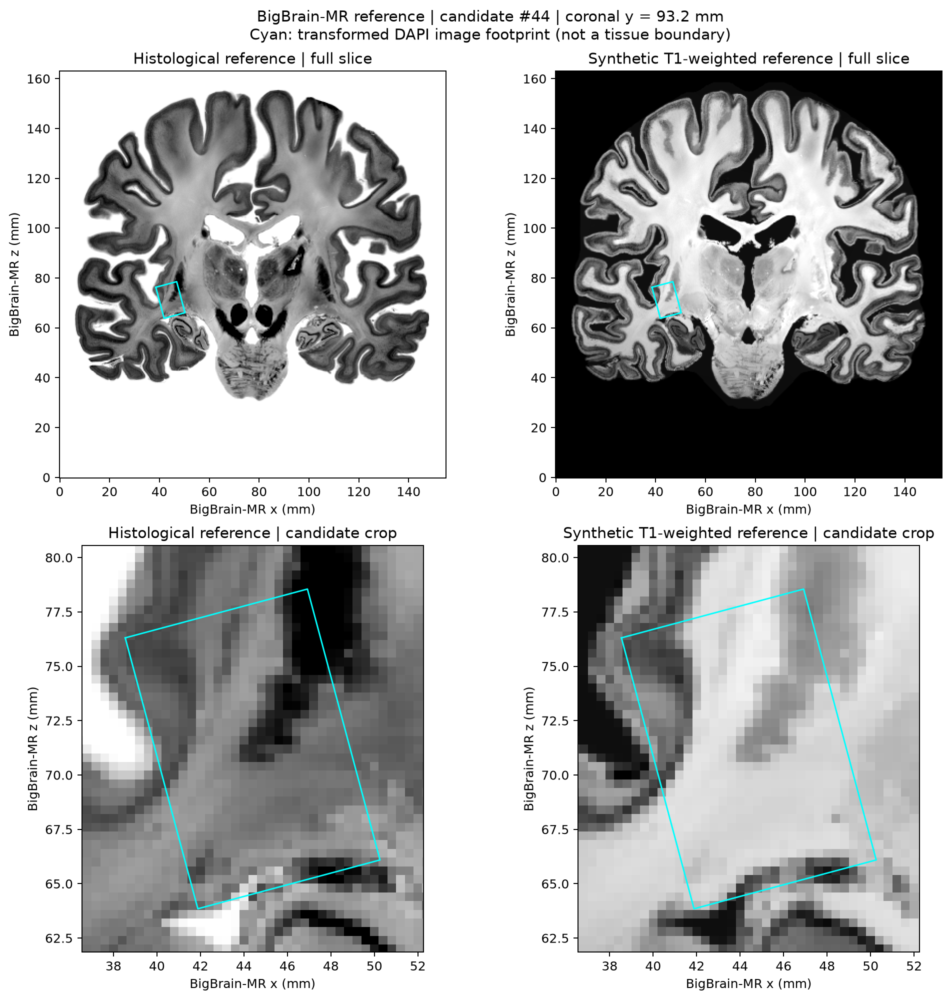
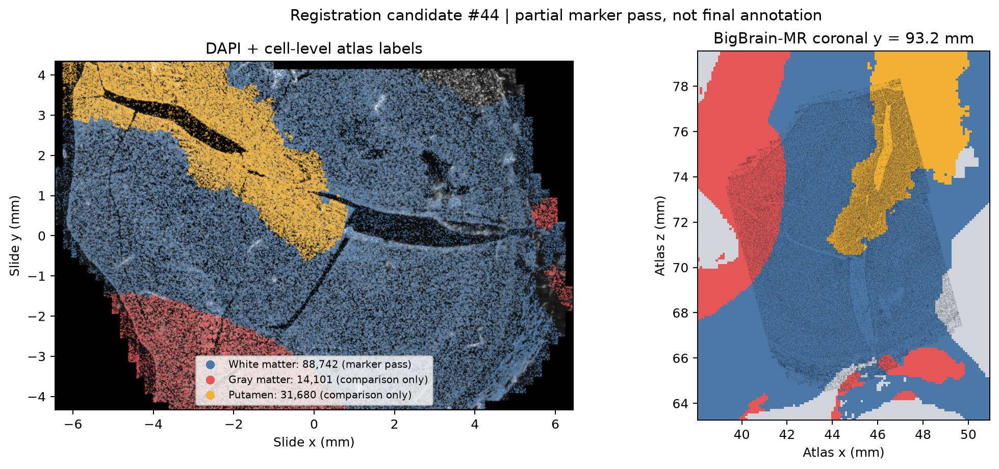
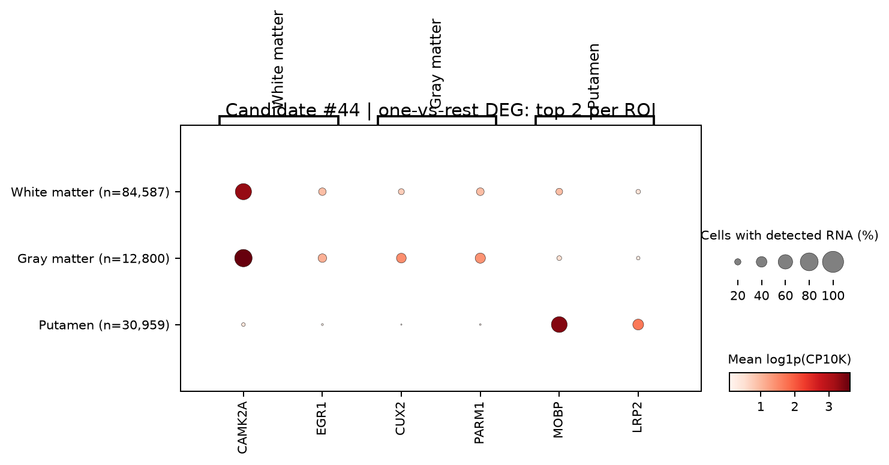
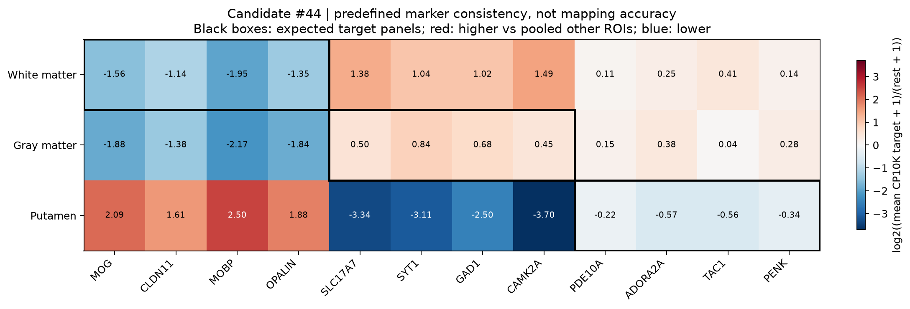

# Exploratory regional mapping with BigBrain-MR

## Abstract

본 프로젝트는 DAPI 영상과 공간 전사체 세포 좌표를 사람 **BigBrain-MR** reference에 정합하고, 영상·세포 밀도·유전자 마커의 일관성을 함께 평가하는 탐색적 regional mapping 파이프라인이다. 저장소 이름의 CCF는 프로젝트 명칭이며, 실제 사용한 지도는 **마우스 Allen CCFv3가 아닌 사람 BigBrain-MR의 20개 조직·해부학적 라벨**이다.

137,627개 세포와 1,000개 유전자 패널을 포함한 약 12.899 × 8.674 mm DAPI 영상을 대상으로, 400 µm reference에서 관상 절편 480개와 회전각 72개를 검색하고 100 µm 라벨로 세포별 영역을 배정하였다. 초기 후보 10개를 100개로 확장한 뒤, 국소 세포 밀도 hotspot과의 겹침 및 사전 정의 마커의 발현 방향으로 후보를 평가하였다. 엄격한 마커 기준을 통과한 후보는 없었으며, 민감도 분석을 거쳐 완화한 **주요 ROI 하나 이상·마커 최소 3개·양의 검출률 차이·방향 일치 블록 50% 이상** 조건에서는 영상 정합 순위 44번 후보의 백질 영역만 통과하였다. 그러나 전체 영역 간 비교에서는 백질 및 Putamen의 마커가 기대와 반대 방향을 보여, 이 후보 역시 신뢰 가능한 최종 해부학적 annotation으로 확정하지 않았다.

분석 상태: **2026-11-20 최종 기록 기준, 단일 후보의 부분적 마커 지지만 확보하였으며 최종 voting·ensemble mapping은 생성하지 않았다.**

## Results

### 1. 파이프라인과 재실행

실행 노트북은 [CCF/Untitled.ipynb](./CCF/Untitled.ipynb)이며, 마커 선별 함수는 [bigbrain_marker_screen.py](./CCF/bigbrain_marker_screen.py)에 있다.

```text
DAPI + 세포 좌표 + 발현 행렬
  → 좌표 변환·조직 마스크·찢김/저밀도 구역 처리
  → BigBrain-MR 400 µm 영상에서 절편·회전·위치 검색
  → 서로 다른 영상 정합 후보 TOP100
  → 100 µm atlas 복셀 조회 및 세포별 조직 라벨 배정
  → 100/200 µm 세포 밀도 hotspot과 atlas ROI의 F1 재랭킹
  → 사전 정의 마커의 공간 블록 내 방향성 평가
  → 컷오프 민감도 분석 및 ROI별 후보 선별
  → 통과 후보가 2개 이상이면 voting·F1 가중 ensemble
  → 현재 결과: 부분 통과 후보 1개이므로 최종 통합 미실행
```

#### 입력과 환경

- 원본 입력: `adata.h5ad`, `manifest.json`, `micron_to_mosaic_pixel_transform.csv`, `mosaic_DAPI_z0_downsampled.tif`.
- 입력 원본은 작업 디렉터리 밖에 있어 **이 저장소에 포함하지 않았다**. 재실행하려면 별도로 준비해야 한다.
- 노트북 첫 데이터 셀의 `DATA_DIR`, `OUTPUT_DIR`와 뒤쪽 reference/복원 셀에 남아 있는 로컬 절대 경로를 실행 환경에 맞게 수정해야 한다. 보존된 출력에도 원래 실행 환경의 경로가 남아 있다.
- 기존 실행 환경: Python 3.11 계열의 `scrna` conda 환경. 완전히 고정된 dependency lockfile은 제공하지 않으므로 실행 환경을 별도로 확인해야 한다.
- 주요 패키지: `scanpy`, `anndata`, `numpy`, `pandas`, `scipy`, `statsmodels`, `matplotlib`, `opencv-python`, `nibabel`, `tifffile`, `scikit-image`, `requests`, `ipywidgets`. 노트북 실행에는 Jupyter/IPython 환경이 필요하다.
- BigBrain-MR reference는 [Zenodo](https://zenodo.org/records/7432527)에서 실행 시 다운로드한다. 전체 검색에는 수 분 이상과 수 GB 수준의 메모리가 필요하다.
- 보존된 마커·DEG CSV를 이용하는 후반 민감도/평가 셀은 전체 영상 검색을 다시 하지 않고 실행할 수 있다. 세포 복셀 투영 및 DEG 재계산에는 입력 데이터와 reference가 필요하다.
- 기준선 TOP10 산출물과 최신 TOP100·마커 선별 산출물을 구분해야 한다. TOP100 밀도 셀은 전체 랭킹을 저장한 뒤 기존 TOP10 비교용 함수의 입력은 별도로 유지한다.

#### 정합과 hotspot 점수

- 물리적 크기를 유지한 2D rigid 회전·이동 검색이며, 피질 변형을 추정하는 비선형 정합은 아니다.
- atlas 조직 밖 또는 CSF에 배정되는 세포가 5% 이상인 후보를 제외하고, 100 µm 라벨로 다시 확인한다.
- 고밀도 구역과 합성 T1의 매우 어두운 구역이 겹치는 후보도 기존 검색 조건으로 제외한다. 이는 경험적 제약이지 조직의 정답 기준이 아니다.
- 검색은 x/z 약 3.2 mm, y 약 2 mm 공간 bin 및 인접 후보 거리 조건으로 중복을 억제한다.
- hotspot은 약 100 µm 격자에서 면적 보정 세포 밀도를 계산하고, 국소 σ=100/200 µm와 배경 σ=500 µm의 비율을 이용해 정한다.
- 각 스케일의 ROI–hotspot 겹침을 `F1 = 2 × intersection / (ROI bins + hotspot bins)`로 계산하며, 두 스케일 중 작은 값을 `fit_score`로 사용한다.
- 1 mm 혼합 라벨 블록에서 두 스케일 모두 밀도 초과가 있는 ROI를 후보 지지 근거로 사용한다. **F1은 정합 정확도나 확률이 아니다.**
- 후보 랭킹의 대표 `region`은 hotspot F1이 높은 영역이다. 모든 세포의 영역, 가장 많은 세포가 있는 영역, 마커가 지지하는 영역과 같다는 뜻은 아니다.

### 2. 초기 TOP10 결과와 라벨 뒤바뀜 점검

초기 최상위 후보에서는 세포 77.25%가 White matter, 22.75%가 Gray matter로 배정되었다. 마커 필터가 없는 TOP10 voting에서는 백질 81.33%, 회백질 18.67%, F1 가중 ensemble에서는 백질 80.81%, 회백질 19.19%였다. 두 방법의 세포 라벨 일치율은 약 99.32%였다.

그러나 이 일치율은 같은 후보 풀을 공유한 결과로, 독립적인 해부학적 검증이 아니다. 초기 voting 결과에서 `MOG` 검출률은 백질 24.0% / 회백질 70.7%, `SLC17A7`은 백질 68.6% / 회백질 19.4%로 기대 방향과 반대였다.

점검 당시 공식 BigBrain-MR Table I의 **1=White matter, 2=Gray matter**와 코드의 이름 매핑은 일치하였다. 원본 100 µm NIfTI 복셀 직접 조회 및 투표 재계산에서도 초기 저장 annotation과 세포 ID의 불일치를 확인하지 못했다. 따라서 단순히 이름 1·2를 바꾸는 방식으로 보정하지 않았다. 이 점검은 최종 정합 위치가 맞다는 증거는 아니다.

관련 기준선 자료:
[후보별 라벨 수](./CCF/BigBrain_top10_region_counts.csv) ·
[TOP10 voting/ensemble](./CCF/BigBrain_top10_voting_ensemble.png) ·
[기준선 메타데이터](./CCF/BigBrain_top10_consensus_metadata.json).

### 3. TOP100 마커 기반 후보 선별

[TOP100 랭킹](./CCF/BigBrain_fit_candidate_ranking_top100.csv) 중 96개가 기존 밀도 기준을 통과했다. 총 발현량 0인 세포 6,893개는 마커 검증 및 최신 후보의 DEG에서 제외하였다.

마커 패널은 다음과 같다. 이들은 세포 유형 또는 조직 구성의 근거이며, 해부학적 영역의 전용 마커로 간주하지 않는다.

| 평가 대상 | 탐색 마커 | 확인 마커 | 공간 블록 비교 대상 |
|---|---|---|---|
| White matter | MOG, CLDN11 | MOBP, OPALIN | Gray matter |
| Gray matter | SLC17A7, SYT1 | GAD1, CAMK2A | White matter |
| Putamen | PDE10A, ADORA2A | TAC1, PENK | Gray matter |

약 2 mm 체커보드에서 탐색/확인 마커를 서로 다른 블록에 적용하였다. 각 블록의 비교하는 두 영역에 각각 발현 총량이 0이 아닌 세포가 20개 이상 있어야 하며, 단계마다 비교 가능한 블록을 최소 3개 요구하였다. 전체 세포의 5% 이상을 차지하는 라벨을 주요 ROI로 취급하였다.

원래 기준은 마커별 검출률 차이 중앙값 ≥2%p, 양의 방향 블록 비율 ≥2/3, 모든 주요 ROI의 네 마커 통과였다. 이 조건에서는 **0/100개**가 통과했다. 모든 후보가 실제로 네 마커를 평가할 수 있었던 것은 아니다. 설정된 패널이 없는 영역 및 비교 블록이 부족한 경우도 통과시키지 않았다.

최신 TOP100 실행 결과:
[후보별 판정](./CCF/BigBrain_marker_screen/20261120T003919.939246Z/candidate_audit.csv) ·
[마커별 근거](./CCF/BigBrain_marker_screen/20261120T003919.939246Z/marker_evidence.csv) ·
[실행 설정](./CCF/BigBrain_marker_screen/20261120T003919.939246Z/summary.json).

### 4. 컷오프 민감도와 완화된 조건의 결과

40개 컷오프 조합을 비교하였다. 검출률 차이 컷오프를 2%p에서 0%p로 낮추더라도 ROI당 네 마커를 유지하면 모든 주요 ROI를 통과한 후보는 없었다. 여기서 **0%p에서도 차이가 정확히 0인 경우는 제외**하고 양의 차이만 인정하였다.


오른쪽 그림의 실선은 모든 주요 ROI 통과, 점선은 주요 ROI 하나 이상 통과를 뜻한다. y축은 세포나 환자 수가 아닌 **정합 후보 수**다. 마커 한 개까지 허용하면 모든 주요 ROI를 통과한 후보가 2개(영상 정합 순위 97·98번)였지만, 이후 사용한 조건은 아래의 마커 최소 세 개 조건이다.

| 최종 탐색 조건 | 설정 |
|---|---|
| ROI 범위 | 주요 ROI 하나 이상 |
| ROI당 최소 마커 | 3개 |
| 검출률 차이 | >0%p |
| 양의 방향 블록 비율 | ≥50% |
| 기존 밀도·블록 조건 | 유지 |

이 조건에서 **44번 후보의 백질만 통과**했다. `MOG`, `CLDN11`, `MOBP`, `OPALIN` 네 마커 모두 백질–회백질 공간 블록 비교에서 양의 방향을 보였다. 세 영역을 각각 평가한 결과는 다음과 같다.

| 주요 ROI 및 밀도 기준을 만족한 후보 | 통과 | 방향 미충족 | 비교 블록 부족 |
|---|---:|---:|---:|
| White matter: 84개 | 1 | 65 | 18 |
| Gray matter: 69개 | 0 | 66 | 3 |
| Putamen: 7개 | 0 | 0 | 7 |

영역별 분모는 중복 가능한 후보 수이므로 합산하면 안 된다. Putamen은 **판정 불가**이지 마커 반대 방향으로 탈락한 일곱 후보라는 뜻이 아니다.

통과 후보가 한 개이므로 최소 두 후보를 요구하는 최종 voting/ensemble을 실행하지 않았다. 기존 `BigBrain_top10_*` 파일은 마커 검증 전 기준선이며 최종 결과가 아니다.

[완화 조건의 선별 근거](./CCF/BigBrain_marker_screen/20261120T003919.939246Z/marker_selection_any_roi_min3_0pp.csv) ·
[영역별 전체 판정](./CCF/BigBrain_marker_screen/20261120T003919.939246Z/region_specific_candidate_audit.csv).

### 5. 44번 후보의 reference와 정합 이미지

44번 후보의 변환은 회전 285°, x=44.4 mm, y=93.2 mm, z=71.2 mm이다. 대표 밀도 영역은 Putamen이고 `fit_score`는 약 0.302이지만, 완화된 마커 필터를 통과한 영역은 백질이다.



위 그림은 400 µm reference의 실제 조직 영상과 **합성 T1**이다. 위 행은 전체 절편, 아래 행은 후보 영역 확대다. 청록색 사각형은 원본 DAPI 영상 전체의 물리적 범위를 변환한 것으로 실제 조직 경계가 아니다.



색상은 세포의 atlas 라벨 배정이다. 백질의 부분적인 마커 통과를 회백질·Putamen의 annotation 검증으로 확대 해석해서는 안 된다.

### 6. 영역별 one-vs-rest DEG와 상위 두 유전자

현재 44번 후보의 White matter, Gray matter, Putamen을 각각 다른 두 영역의 세포 전체와 비교하였다. 전체 유전자 패널로 CP10K 정규화 후 log1p 변환하고, 양측 Mann–Whitney U 및 비교별 전체 유전자 BH 보정을 적용하였다.

상위 유전자 선택 조건은 q<0.05, `log2((평균 CP10K target+1)/(평균 CP10K rest+1)) ≥0.25`, target 검출률 ≥10%, rest보다 높은 검출률이며, log2FC 내림차순으로 영역당 두 개를 선택하였다.

| 현재 atlas 배정 라벨 | one-vs-rest 상위 두 유전자 |
|---|---|
| White matter | CAMK2A, EGR1 |
| Gray matter | CUX2, PARM1 |
| Putamen | MOBP, LRP2 |



점 크기는 검출률, 색은 전체 세포 평균 log1p(CP10K)다. 이 유전자는 **현재 라벨로 나눈 집단의 차이**이며 독립적인 영역 특이 마커가 아니다. 특히 Putamen에서 `MOBP`, 백질에서 `CAMK2A`가 선택된 결과는 오히려 해부학적 배정의 재검토가 필요함을 보여준다. Pooled rest 비교는 다른 두 ROI 각각에 대한 특이성을 보장하지 않는다. 세포 수준 p값은 공간적 상관 및 생물학적 반복을 반영하지 않으며, CSV의 0 p값은 수치적 underflow일 수 있다.

[전체 3,000행 DEG](./CCF/BigBrain_marker_screen/20261120T003919.939246Z/candidate_44_one_vs_rest_DEG.csv) ·
[선택된 여섯 유전자 통계](./CCF/BigBrain_marker_screen/20261120T003919.939246Z/candidate_44_one_vs_rest_top2_markers.csv).

### 7. 마커 기반 regional mapping 신뢰도 평가

DEG로 새로 고른 유전자와 구분해 사전 정의한 네 마커씩을 다시 확인하였다.

| 영역 | 전체 ROI one-vs-rest | 공간 블록 비교 | 판단 |
|---|---|---|---|
| White matter | 수초 마커 4/4 반대 방향 | Gray matter 대비 4/4 지지 | 국소·전역 결과 상충 |
| Gray matter | 신경세포 마커 4/4 지지 | White matter 대비 1/4 지지 | 부분적·비일관적 근거 |
| Putamen | 선조체 마커 4/4 반대 방향 | 비교 블록 부족 | 배정을 지지하기 어려움 |



검은 테두리는 해당 라벨에서 기대하는 마커 패널이다. 색은 전체 ROI의 pooled one-vs-rest log2FC이며, 빨강은 증가, 파랑은 감소다. 공간 블록 비교와 전체 비교는 비교 대상과 공간 구성이 다르므로 결과가 달라질 수 있다. 백질의 국소 마커 통과만으로 mapping의 신뢰도를 높게 선언할 수 없다.

[평가 요약](./CCF/BigBrain_marker_screen/20261120T003919.939246Z/candidate_44_marker_reliability_summary.csv) ·
[마커별 평가 근거](./CCF/BigBrain_marker_screen/20261120T003919.939246Z/candidate_44_marker_reliability_evidence.csv).

## Conclusion

1. **단순한 gray/white 이름 매핑 오류는 확인되지 않았지만 정합 위치의 정확성은 확보되지 않았다.** 올바른 복셀 조회와 일관된 투표 결과만으로 해부학적 타당성이 보장되지 않는다.
2. TOP100으로 후보를 늘려도 엄격한 마커 기준의 통과 후보는 없었다. 완화된 조건에서 44번 후보의 백질이 부분적으로 지지되었으나, 전체 ROI 비교와 상충하여 최종 annotation으로 채택하지 않았다.
3. 현재 얻은 것은 **후보·조직 구성에 대한 탐색적 근거**이지 보정된 신뢰 확률, 독립적인 regional mapping 검증 또는 정상적인 해부학적 경계의 확정이 아니다.
4. 후속 검증에는 원본 절편의 피질–백질 경계 및 알려진 해부학적 landmark, 전체 절편의 조직학적 맥락, 독립 reference/표본, 선별에 쓰지 않은 마커가 필요하다. 평가 가능한 경우 landmark 기반 또는 변형 정합을 도입하고, 최종 선택 후에는 별도 자료로 검증해야 한다.
5. 동일 데이터에서 컷오프를 바꾸고 후보를 선택했으므로 selection bias와 다중 탐색의 영향을 고려해야 한다. 통과 후보를 만들기 위해 라벨을 뒤집거나 기준을 사후 완화한 결과를 독립 검증으로 보고하지 않는다.

### 산출물과 이전 보고서

- [전체 분석 노트북](./CCF/Untitled.ipynb): 실행 출력과 최신 평가 포함.
- [마커 선별 코드](./CCF/bigbrain_marker_screen.py).
- [최신 TOP100 실행 폴더](./CCF/BigBrain_marker_screen/20261120T003919.939246Z/): cutoff, ROI별 선별, reference, DEG, 신뢰도 평가.
- [이전 전체 보고서 PDF](./CCF/BigBrain_분석_전체_보고서.pdf), [이전 알고리즘 상세 보고서 PDF](./CCF/BigBrain_분석_알고리즘_상세_보고서.pdf): **TOP100 마커 검증 전 생성된 과거 자료**다. 최신 결과와 충돌하면 본 README 및 최신 실행 폴더를 기준으로 해석한다.
- 이전 TOP10 실행 폴더와 그림·CSV도 이력 보존 목적으로 포함하였다.
- 작업 디렉터리의 일반 분석 파일을 `CCF/` 아래 보존하였다. Jupyter 커널 IPC 소켓, `__pycache__/`, `.ipynb_checkpoints/`는 실행 임시 항목이므로 제외하였다.

### Reference 및 데이터 이용 조건

- C. Sainz Martinez et al. **BigBrain-MR: a new digital phantom with anatomically-realistic magnetic resonance properties at 100-µm resolution for magnetic resonance methods development.** NeuroImage (2023). [논문](https://doi.org/10.1016/j.neuroimage.2023.120074), [Table I 포함 preprint](https://arxiv.org/abs/2212.08165), [reference 데이터](https://zenodo.org/records/7432527).
- BigBrain-MR 이용 조건: **CC BY-NC-SA 4.0**. Reference를 포함하거나 그로부터 파생된 그림을 재사용할 때 원저작자 표시, 비상업적 이용 및 동일조건변경허락 등 원 데이터의 조건을 확인해야 한다. 이 저장소가 원 데이터의 이용 권리를 새로 부여하는 것은 아니다.
- Siletti et al. **Transcriptomic diversity of cell types across the adult human brain.** Science (2023). [논문](https://doi.org/10.1126/science.add7046). 마커 해석을 위한 배경 문헌이며, 이 저장소의 marker cutoff 또는 정합 정확도를 검증한 자료는 아니다.
- [Allen MERFISH registration tutorial](https://alleninstitute.github.io/abc_atlas_access/notebooks/merfish_ccf_registration_tutorial.html): 좌표→영역 ID 결합의 참고 자료다. 본 파이프라인에서 Allen CCF atlas 또는 튜토리얼의 ANTs 정합을 실행했다는 뜻은 아니다.
